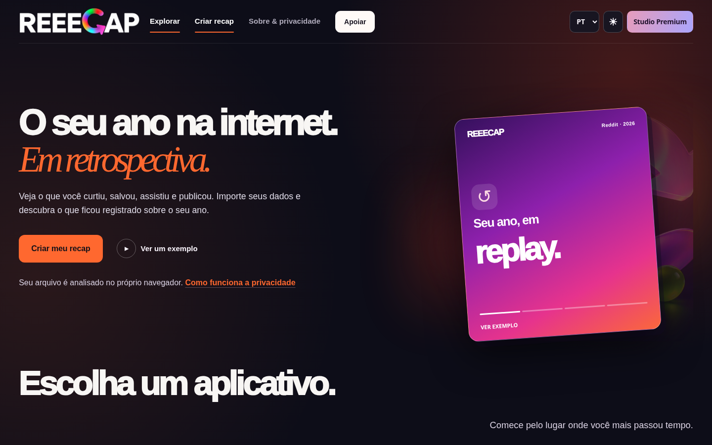
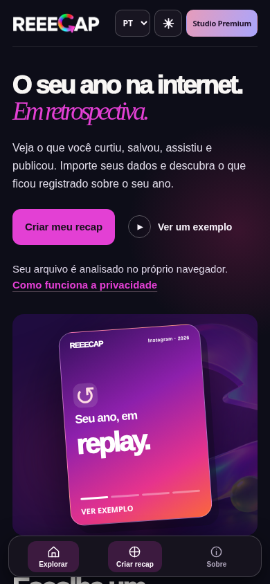
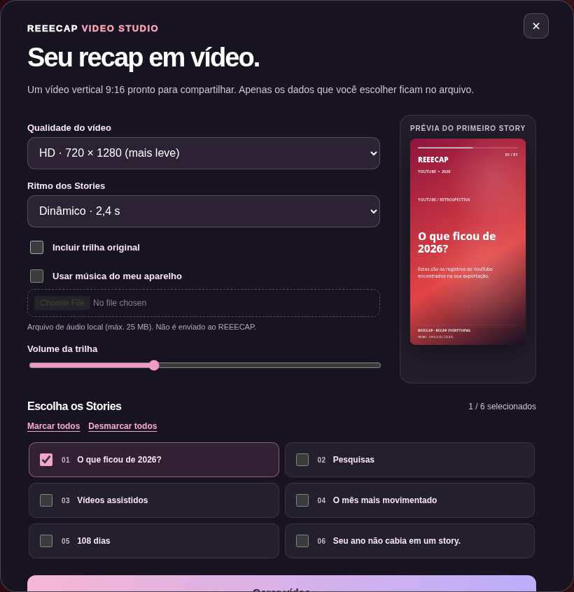
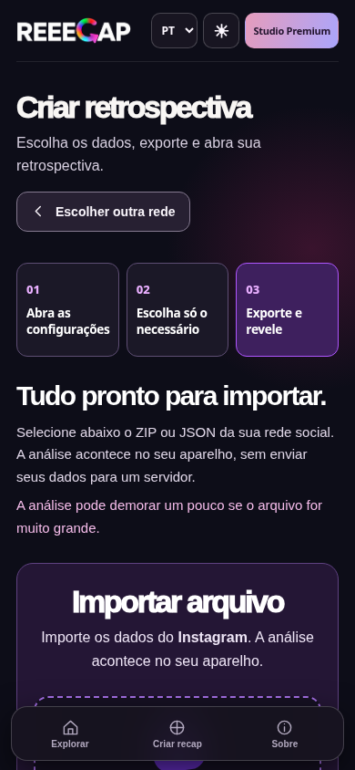

<div align="center">


### Seu ano na internet. Em retrospectiva.

Uma experiência visual para transformar seus próprios dados de atividade digital em Stories, estatísticas e vídeos compartilháveis.


**[Explorar o projeto](#visao-geral)** · **[Baixar](#baixar)** · **[Ver imagens](#previews)** · **[Instalar](#como-executar)**

</div>

---

## Visão geral

O REEECAP importa arquivos que você exporta das plataformas, sem pedir acesso às suas contas. É uma experiência independente inspirada na ideia de retrospectiva anual; **não é afiliado** a Instagram, TikTok, YouTube ou Reddit.

- **Descubra seu ano:** curtidas, interações, vídeos assistidos, pesquisas e outros registros disponíveis nos arquivos.
- **Veja seu recap:** Stories verticais com animações e prévia antes de compartilhar.
- **Exporte o vídeo:** até 1080 × 1920, com música local ou trilha original; formato MP4 ou WebM conforme o navegador.
- **Privacidade local:** o ZIP é lido no seu navegador; não envie senhas, mensagens privadas nem dados de outras pessoas.

## Previews

<table>
  <tr>
    <td width="65%"></td>
    <td width="35%"></td>
  </tr>
  <tr>
    <td></td>
    <td></td>
  </tr>
</table>

<sub>Imagens reais da interface do REEECAP, capturadas no Chromium com **dados fictícios**. Não representam perfis reais de usuários.</sub>

### Interface 2.3: tema claro e importação responsiva

<table>
  <tr>
    <td width="65%"></td>
    <td width="35%"></td>
  </tr>
</table>

[Ver captura do formulário em tema claro](docs/media/import-light.png).

## Baixar

> **Versão de testes:** ainda há limitações que impedem anunciar o produto como concluído.

**[⬇ Baixar o REEECAP 2.3 (site público, ZIP)](downloads/REEECAP-2.3-publico.zip)**

O download acima está incluído no repositório e funciona mesmo antes de publicar uma GitHub Release. A instalação é um site estático; não é um aplicativo instalável para Windows. Em futuras versões, os pacotes podem ser publicados na seção **Releases** do GitHub para oferecer histórico e notas de versão.

## Como executar

1. Extraia o ZIP baixado.
2. Dentro da pasta, execute `python -m http.server 8000`.
3. Abra `http://localhost:8000` no navegador.
4. Escolha uma rede social, abra a demonstração ou importe um arquivo ZIP/JSON/CSV exportado por você.

Para publicar via GitHub Pages, envie os arquivos do diretório do site com `index.html` na raiz e ative **Settings → Pages → Deploy from a branch**.

## Plataformas

| Rede | Dados analisados quando presentes | Formato |
|:--|:--|:--|
| Instagram | Interações, curtidas, comentários, publicações e relacionamentos | JSON/ZIP |
| TikTok | Curtidas, favoritos, histórico e comentários | JSON/ZIP |
| YouTube | Visualizações e pesquisas do Takeout | JSON/ZIP |
| Reddit | Posts, comentários, votos e salvos | CSV/ZIP |

O REEECAP não inventa estatísticas quando a plataforma omite dados; formatos variam conforme o tipo de exportação e o idioma.

## Música de qualidade, com os créditos certos

A interface oferece links oficiais para **Legacy**, **Catalyst** e **Uprising**, trilhas do compositor **Scott Buckley**, licenciadas sob **Creative Commons Attribution 4.0**. O download da obra é feito no site do compositor, depois você seleciona o MP3 local para compor o vídeo. Não há redistribuição dos MP3 de terceiros neste repositório. A atribuição ao autor é necessária na publicação. [Detalhes e créditos](MUSICAS_E_LICENCAS.md).

## Estado do projeto

| Recurso | Estado |
|:--|:--|
| Stories e estatísticas, PT/EN/ES | Implementados, testes automatizados com dados sintéticos |
| Renderização de vídeo com trilha | Implementada; depende de codec no navegador |
| Prints de exportação | Referências visuais externas com fonte; carregamento somente após toque do visitante |
| Arquivos exportados por contas reais | Ainda não cobertos pela bateria de testes |
| Studio Premium | Separado do repositório público; autenticação/cobrança não ativadas |

A documentação sobre requisitos pendentes está em [ESTADO_DE_VALIDACAO.md](ESTADO_DE_VALIDACAO.md). A documentação de privacidade está em [PRIVACIDADE.md](PRIVACIDADE.md).

## Estrutura de código

```text
index.html             # interface do site
app.js / worker.js     # fluxo e leitura local de arquivos
video.js               # renderização e gravação 9:16
atelier.js             # guias de exportação por plataforma
locale-full.js         # textos PT/EN/ES
assets/                # marca, ícones e trilha original
docs/media/            # capturas reais do REEECAP para o README
tests/                 # testes automatizados
downloads/             # pacote ZIP público versionado
```

## Licença e autoria

O código do REEECAP é disponibilizado sob [MIT](LICENSE). O conteúdo de terceiros permanece sob as licenças e direitos de seus respectivos titulares. Veja [ATTRIBUTION.md](ATTRIBUTION.md), [MUSICAS_E_LICENCAS.md](MUSICAS_E_LICENCAS.md) e [CAPTURAS_E_FONTES.md](CAPTURAS_E_FONTES.md).

<div align="center">
  <sub>REEECAP · feito para reviver o que ficou no seu ano, não para coletar suas senhas.</sub>
</div>
