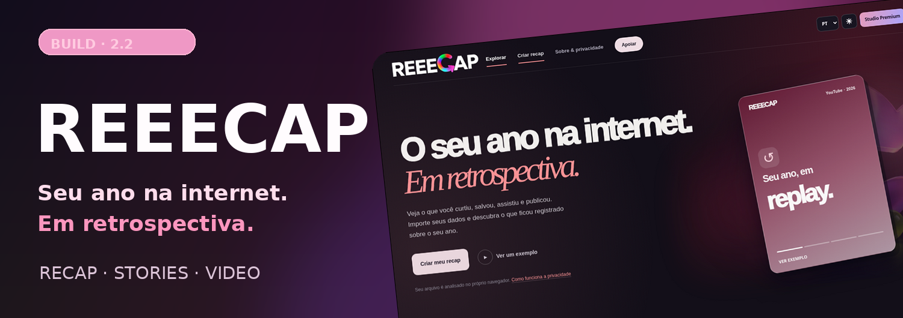
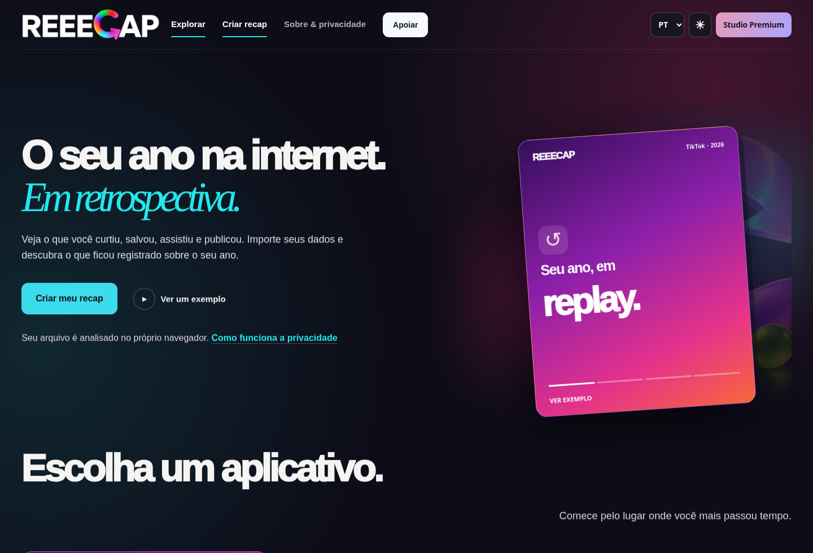
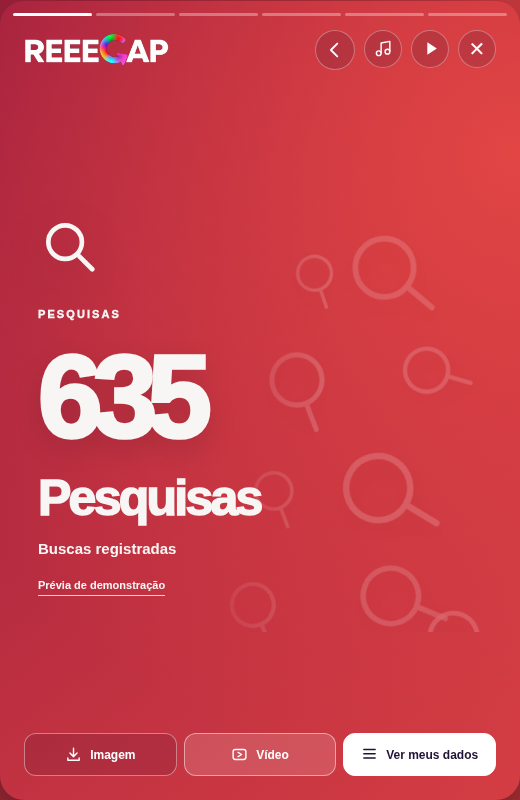
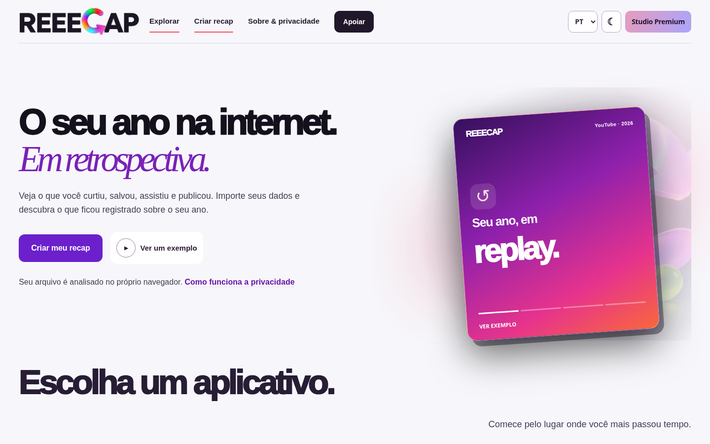

<div align="center">



### Seu ano na internet. Em retrospectiva.

Uma experiência visual para transformar seus próprios dados de atividade digital em Stories, estatísticas e vídeos compartilháveis.


**[Explorar o projeto](#visao-geral)** · **[Baixar](#baixar)** · **[Ver imagens](#previews)** · **[Instalar](#como-executar)**

</div>

---

## Visão geral

O REEECAP importa arquivos que você exporta das plataformas, sem pedir acesso às suas contas. É uma experiência independente inspirada na ideia de retrospectiva anual; **não é afiliado** a Instagram, TikTok, YouTube, Reddit, Spotify ou Facebook.

- **Descubra seu ano:** curtidas, interações, vídeos assistidos, pesquisas e outros registros disponíveis nos arquivos.
- **Veja seu recap:** Stories verticais com animações e prévia antes de compartilhar.
- **Exporte o vídeo:** até 1080 × 1920, com música local ou trilha original; formato MP4 ou WebM conforme o navegador.
- **Privacidade local:** o ZIP é lido no seu navegador; não envie senhas, mensagens privadas nem dados de outras pessoas.

## Previews

<table>
  <tr>
    <td width="65%"></td>
    <td width="35%"></td>
  </tr>
  <tr>
    <td></td>
    <td></td>
  </tr>
</table>

<sub>Imagens reais da interface do REEECAP, capturadas no Chromium com **dados fictícios**. Não representam perfis reais de usuários.</sub>

### Interface responsiva e nova biblioteca de estilos

<table>
  <tr>
    <td width="65%"></td>
    <td width="35%"></td>
  </tr>
</table>

[Ver captura do formulário em tema claro](docs/media/import-light.png).

### Três estilos de vídeo com composições próprias

<table><tr><td><br/>Neon Motion</td><td><br/>Noir Editorial</td><td><br/>Paper Cut</td></tr></table>

As imagens são capturas do renderizador de vídeo, com **dados sintéticos** usados apenas nos testes. O mesmo renderizador compõe o vídeo exportado. A cor de destaque, os Stories, a duração e a trilha podem ser selecionados pelo usuário.

## Baixar

> **Versão de testes:** ainda há limitações que impedem anunciar o produto como concluído.

**[Baixar REEECAP 5.0 — código público (.zip)](downloads/REEECAP-5.0-publico.zip)**

O download acima está incluído no repositório e funciona mesmo antes de publicar uma GitHub Release. A instalação é um site estático; não é um aplicativo instalável para Windows. Em futuras versões, os pacotes podem ser publicados na seção **Releases** do GitHub para oferecer histórico e notas de versão.

## Como executar

1. Extraia o ZIP baixado.
2. Dentro da pasta, execute `python -m http.server 8000`.
3. Abra `http://localhost:8000` no navegador.
4. Escolha uma rede social, abra a demonstração ou importe um arquivo ZIP/JSON/CSV exportado por você.

Para publicar com vídeos e músicas **dentro do aplicativo**, envie este repositório, ative **Settings → Pages → Source: GitHub Actions**, e execute o workflow **REEECAP with local media**. Ele baixa e otimiza os arquivos durante o build, valida 4 vídeos e 3 músicas locais e só publica se essa validação passar. Não exige uploads do visitante. Em ambiente de desenvolvimento sem os arquivos, o app tenta carregar fontes oficiais externas.

## Plataformas

| Rede | Dados analisados quando presentes | Formato |
|:--|:--|:--|
| Instagram | Interações, curtidas, comentários, publicações e relacionamentos | JSON/ZIP |
| TikTok | Curtidas, favoritos, histórico e comentários | JSON/ZIP |
| YouTube | Visualizações e pesquisas do Takeout | JSON/ZIP |
| Reddit | Posts, comentários, votos e salvos | CSV/ZIP |
| Spotify | Reprodução musical, episódios e duração real agregada dos registros | JSON/ZIP (básico e ampliado) |
| Facebook | Posts, comentários e reações datadas, quando identificáveis no export | JSON/ZIP (suporte experimental) |

O REEECAP não inventa estatísticas quando a plataforma omite dados; formatos variam conforme o tipo de exportação e o idioma. Se você importar um arquivo de outra rede, o site só identifica automaticamente a rede quando o nome dos arquivos é inequívoco. Dados privados como mensagens são descartados do processamento.

O Spotify publica as diferenças entre o histórico normal e o ampliado no [guia oficial](https://support.spotify.com/article/understanding-your-data/); o Facebook/Instagram usam a [Central de Contas da Meta](https://about.fb.com/news/2023/10/manage-your-information-across-apps/).

## Música e imagens em movimento

O player agora oferece músicas reais identificadas, **Cat Walk**, **Rising Forest** e **Techno Fest Vibes**, com escolha e audição no próprio editor, sem pedir um MP3 ao visitante. O rolo usa clipes filmados de verdade do Mixkit, não vídeos inventados nem Reels de contas reais. O build baixa e hospeda essas mídias no **mesmo domínio** do site.

**Atenção:** o ZIP do repositório contém o **código e instalador dos assets**, e não os MP4s/MP3s de terceiros. O material só fica de fato embutido no **site publicado pelo workflow** depois da validação dos downloads. Veja [licenças de mídia](LICENCAS_MIDIA_5.md) e [status verificável](STATUS_5.md).

O tutorial abre como janela modal grande, com três etapas obrigatórias por rede e fundo desfocado. As capturas autênticas são carregadas automaticamente quando presentes; diagramas são rotulados como diagramas e usados somente como reserva. Ainda falta reunir capturas reais para *todas* as telas das seis redes.

## Estado do projeto

| Recurso | Estado |
|:--|:--|
| Stories e estatísticas, PT/EN/ES | Implementados para seis plataformas com testes sintéticos, sem validar todas as variantes de exportações reais |
| Renderização de vídeo com trilha | MP4 H.264 sem música testado; com música depende da codificação do navegador (WebM pode ser necessário) |
| Prints de exportação | Tutorial obrigatório em modal de três etapas; usa capturas self-hosted quando presentes, com fallback remoto ou diagrama identificado |
| Arquivos exportados por contas reais | Ainda não cobertos pela bateria de testes |
| Personalização visual do vídeo gratuito | Três temas com composição distinta e cor de destaque, duração e seleção de Stories |
| Studio Premium | Editor privado separado; autenticação/cobrança não ativadas |

A documentação sobre requisitos pendentes está em [ESTADO_DE_VALIDACAO.md](ESTADO_DE_VALIDACAO.md). Uma análise de concorrência e planejamento por prioridade está em [ESTRATEGIA_E_EVOLUCAO.md](ESTRATEGIA_E_EVOLUCAO.md). A documentação de privacidade está em [PRIVACIDADE.md](PRIVACIDADE.md).

## Estrutura de código

```text
index.html             # interface do site
app.js / worker.js     # fluxo e leitura local de arquivos
video.js               # renderização e gravação 9:16
atelier.js             # guias de exportação por plataforma
locale-full.js         # textos PT/EN/ES
assets/                # identidade e clipes/músicas instalados no build
docs/media/            # capturas reais do REEECAP para o README
tests/                 # testes automatizados
downloads/             # pacote ZIP público versionado
```

## Licença e autoria

O código do REEECAP é disponibilizado sob [MIT](LICENSE). O conteúdo de terceiros permanece sob as licenças e direitos de seus respectivos titulares. Veja [ATTRIBUTION.md](ATTRIBUTION.md), [MUSICAS_E_LICENCAS.md](MUSICAS_E_LICENCAS.md) e [CAPTURAS_E_FONTES.md](CAPTURAS_E_FONTES.md).

<div align="center">
  <sub>REEECAP · feito para reviver o que ficou no seu ano, não para coletar suas senhas.</sub>
</div>


### Vídeos reais nos Stories

O rolo de filme usa clipes gravados de verdade, que o workflow inclui no site publicado. Não são vídeos do perfil analisado. O ambiente sem mídia local utiliza fallback online. [Origem e licença dos clipes](LICENCAS_MIDIA_5.md).
